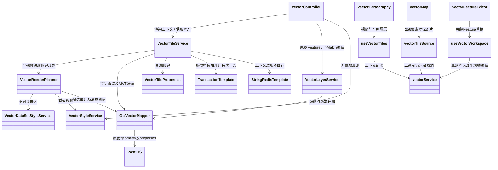
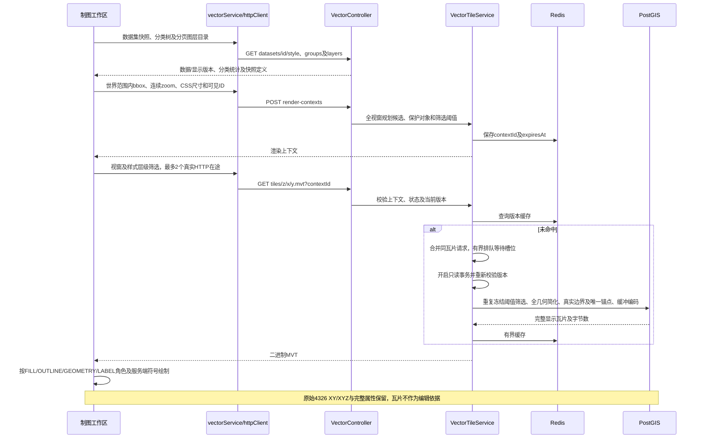
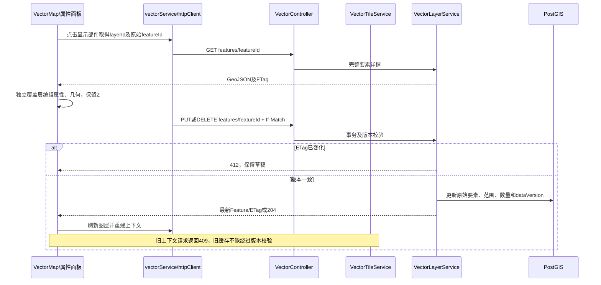

# Ocean Admin Service 架构说明

## 技术基线

- Java 21
- Spring Boot 4
- Spring MVC SSE
- MyBatis-Plus
- JWT（登录鉴权）
- PostgreSQL （数据库服务）
- Flyway （数据库迁移）
- Redis （缓存中间件）
- Knief4j （接口文档）

## 当前边界

当前只建设三个平台侧领域：

1. `identity`：用户、平台、角色、权限、认证和会话。
2. `audit`：登录、操作、安全和异常审计。
3. `workbench`：通用平台指标与业务卡片聚合。

三个领域位于同一个 `ocean-platform-core` Maven 模块，使用包边界隔离，避免初期过度拆分。

## 未来业务子平台

新的业务子平台添加为 `ocean-business-<code>` Maven 模块，例如：

```text
ocean-business-vision
ocean-business-analyst
ocean-business-cloud
```

业务模块只能通过 `org.ocean.admin.platform.api` 使用平台能力。禁止直接访问平台模块的实体、Mapper 和数据表。

## 数据所有权

统一实时事件信封 `EventMessage<T>` 与发布契约 `RealtimeEventPublisher` 位于 `ocean-kernel` 的 `org.ocean.admin.kernel.realtime` 包，不依赖Web、Servlet或SSE实现。平台SSE入口与发布实现位于 `ocean-platform-core` 的 `org.ocean.admin.platform.workbench` 包，GIS对应实现位于 `ocean-business-geo` 的 `org.ocean.admin.gis.realtime` 包，两侧各自实现kernel中的发布契约，不反向依赖bootstrap。进度快照、业务投影与数据库重建位于GIS模块的 `progress` 包。MonitorController与GisRealtimeEventController分别提供 `/api/platform/monitor/metrics` 与 `/api/gis/events/stream`，由服务端固定事件域为platform与gis，省略topics仅订阅所属域，跨域主题返回400，不保留全域入口。SystemMetricsSsePublisher与GisRealtimeSsePublisher分别维护有界串行发送、心跳、异步回收、线程池和连接上限，配置分别使用 `ocean.platform.realtime.sse` 与 `ocean.gis.realtime.sse`；业务服务通过构造器上的 `@Qualifier` 选择所属域的发布器。bootstrap保留WebConfig和Knife4jConfig作为SSE的MVC注册与文档装配，不再提供SSE控制器或发布实现；WebConfig在两个入口的MVC异步响应初始化后分别激活对应发布器，避免框架内部早期缓冲绕过应用队列上限。工作台SystemMetricsEventService仅生产platform.metrics.updated事件，有匹配的平台订阅者时每2秒采集，GIS连接不会触发系统指标采集。两侧SSE均可承载进度之外的域内事件，各类型自定义消息体。所有事件以app.event帧发送，不提供SSE历史重放；前端每次GIS连接成功后通过既有HTTP接口补查状态，按epoch/sequence合并。鉴权暂不调整，两个SSE入口继续公开访问，域隔离与主题筛选仅控制投递范围。

`ProgressSnapshot.progressId` 唯一标识一条实时进度消息。上传、工作区接入、处理及归档共用 ProgressSnapshot、gis.progress 事件和 /api/gis/progress/{progressId} 补查。Redis 保存共享进度快照，通过原子比较更新递增 revision；GIS SSE 经 Redis 转发到各实例的消息连接。进度只描述工作量和阶段，不保存历史文件清单。持久化处理/归档任务仍由数据库提供状态，接入终态短期保留30分钟。

客户端分块上传和工作区扫描登记均逐文件记录真实文件信息，整批收口后自动识别文件组，再放行主入口的空间元数据提取。扫描总量未知时不推算百分比；上传阶段按落盘字节计量。接入 summary 使用 FILE 统计物理文件接收结果，成员随所属组结果归集；去重后的组数量、完成、失败、重复与等待指标使用 FILE_GROUP，缺件或阻塞输入收尾为已接收未解析，不伪装成解析成功。文件仅在执行期间通过 ingest_progress_id 回报进度，结束后解除关联，不建立传输历史或批次文件列表。多实例部署须共享上传、暂存及受控工作区文件存储。

平台业务使用 `ocean_platform` Schema，平台核心表采用 `sys_` 前缀；GIS 业务使用 `ocean_gis` Schema，表采用 `gis_` 前缀。两个 Schema 分别维护唯一的初始化 SQL，业务对象不跨 Schema 混写。

GIS 业务管理以 `gis_file_group` 表示逻辑数据源，单文件也属于组。数据集包含多个组，每个物理成员只归属一个组；文件组不复用 `gis_vector_group` 矢量分类树。`FileGroupController` 提供 `/api/gis/file-groups/page`、详情、读取配置、重试与整组删除，默认列表不展示重复输入追溯记录。`filemeta` 接口保留物理文件查询、下载与删除语义，无法可靠归组时 file_group_id 可为空。上传文件永久以 UUID 平铺存储，工作区原位登记；读取临时目录不改变原始来源。

`FileGroupService` 依据格式、可靠来源路径及内容证据组装成员，校验必要配件，并以规范化成员角色和 SHA-256 建立完整输入指纹；批次、UUID、绝对路径和读取参数不参与去重。上传不按顺序猜配件、不跨批按同名拼接，工作区只有唯一来源证据才补件。摘要及格式头在事务外读取，数据集、组和成员锁内重验来源属性与归属后写入。重复输入保留独占追溯组，通过 duplicate_of_group_id 和 matched_revision 指向规范组，详情返回 effectiveGroupId；不迁移成员、不自动删源，也不重试原组已有失败状态。

组的 assembly_status 区分完整、缺件、未知、能力阻塞和重复，parse_status 保存解析状态及 REIMPORT_REQUIRED。有效成员或读取参数变化才递增 input_revision。`FileSpatialMetadataService` 沿用主入口文件的 metadata_version 和解析租约领取任务，最终提交同时核对文件领取版本与组修订；图层 READY、主入口空间元数据 COMPLETED 和组状态在同一事务完成。配套文件不独立领取，PARKED 是持久等待状态，与接入收口期间的 WAITING 租约分离。失败组可显式重试，缺件或缺配置的首次有效输入就绪后自动解析；已成功成果发生变化时等待显式重导，已有 READY 图层及编辑内容不会自动覆盖。

`GdalDatasetReader` 统一准备文件组读取上下文。GeoJSON、GeoTIFF 复用既有 Java 解析链路，SHP、DXF、MIF、TAB、CSV、GPX、DWG 以及 IMG、JPG/JPEG、PNG、GIF、GRIB2 统一通过独立 Java 读取进程中的 GDAL/OGR Java API 完成元数据读取、空间参考处理及格式转换。主 JVM 不加载 JNI，工作进程独立持有并显式释放 Dataset、Layer、SpatialReference 和转换选项，退出后释放全部原生资源。源文件只读，临时副本和规范化中间文件随上下文清理。驱动及文件版本需真实可用，DWG 不保证在普通 GDAL 构建中可读；缺驱动、缺 CRS、无定位或必要配件不足均明确阻塞。CSV 必须提供 sourceCrs、xField、yField，CAD 需明确源 CRS；不猜测 WGS84，不把 world file 当作 CRS。读取配置仅接受明确 EPSG、OGC:CRS84 或 WKT，禁止外部文件、URL 引用。工作进程以相同版本的 Java JAR、JNI 桥接库和 GDAL 核心库为能力基础，检查实际源驱动及 GeoJSON/GeoTIFF 目标写能力；驱动清单不能替代实际文件读取验证。非强制读取无法取得原始范围时，来源范围显式保存 JSON null，不沿用转换后 WGS84 范围，避免原始 CRS 与范围坐标不一致。原始栅格必须真实具备仿射定位，不能将 API 在无定位时返回的默认单位变换当作地理参考。

主服务通过受控 Java 子进程启动读取任务，保留租约心跳、硬超时、日志与结果大小限制、输出空间限制和进程树终止。工作进程以结构化结果返回来源元数据及临时标准文件；GDAL 原生异常和进程退出映射到现有文件组错误语义。Java API 全部运行于子进程，避免原生崩溃或无法响应线程中断的调用影响主服务。POM、镜像源码及运行时版本固定为 3.13.0，旧 GDAL/OGR 命令路径配置已移除。

可编辑矢量业务仍位于 `ocean-business-geo`。既有链路及 GDAL 转换后的来源图层经既有流式 GeoJSON 读取、分类与分批入库链路生成业务图层，保留来源图层键、Feature 序号和几何路径；完整成功后统一开放。不新增独立矢量导入任务。原始文件保存在文件存储，PostGIS 保存真实要素、图层范围与源空间参考，编辑不回写原文件。空间查询继续通过索引组合同一图层的矩形与推荐层级条件。

`ManagedFileInputResolver` 为影像、地形处理选择已完整解析栅格组的主入口，并持久化整组成员、来源、SHA、读取参数及 input_revision 快照。任务提交按数据集、组、成员锁序核对准备期间输入未变化；活动任务保护全组成员。执行期间只消费保存的组快照，核验全部来源并通过同一读取器准备 GeoTIFF，再交给既有切片引擎，结束前再次验证源文件。当前 MANAGED_FILE 不支持矢量组切片。静态成果及发布流程继续使用现有处理任务和瓦片集；上传与下载操作由统一操作日志留痕。

`VectorLayerService` 提供真实几何范围查询及要素编辑，以图层行锁维护数量、范围和数据版本，以要素版本及 HTTP If-Match 防止编辑覆盖。来源文件保持为提取时的数据依据；制图查询访问当前要素，编辑不回写原文件。空间响应使用 GeoJSON，图层管理响应使用统一 ResponseResult。

`VectorStyleService` 管理图层关联的多份样式方案、默认选择及独立ETag版本。接入生成的已识别图层继承数据集分类样式，未知层保持 UNCONFIGURED 且默认关闭；自定义方案仍由样式服务管理。样式写操作锁定图层但不递增 dataVersion。默认切换同时更新原方案和目标方案版本，数据库以部分唯一索引阻止多个默认方案，业务禁止删除当前默认方案。逻辑删除图层后其样式不再可访问。

`VectorStyleRules` 定义引擎无关的 schemaVersion=1 协议，负责有界规则校验、符号默认值补齐及几何/属性/连续zoom匹配。规则取首个匹配项，未匹配隐藏，GeometryCollection按子几何路径匹配并保留要素身份。后端提供持久化定义与匹配预览，前端读取定义后本地渲染；样式不改变要素查询、编辑语义或分页游标，也不作为数据访问权限。

旧式 GeoJSON 的兼容限制在文件入口：`FileSpatialMetadataService` 与文件要素读取共用 `GeoJsonFeatureReader.readSourceCrs`，仅接受顶层明确的 WGS84 命名声明，坐标不转换。子级声明、未知坐标系、空声明和链接型声明拒绝导入；在线编辑继续遵循 RFC 7946。该支持作为长期导入能力保留，停用这些来源并转换存量文件后可移除。

### 动态矢量瓦片及编辑链路

`VectorTileService` 在 GIS 业务模块生成只读显示数据：`VectorRenderPlanner` 固定数据/显示版本、视窗、样式、预算与筛选阈值，Redis持久化短期上下文并限制缓存份数。PostGIS 使用现有空间索引，按属性、连续级别及屏幕尺寸筛选、简化并编码MVT。点、线、面均不网格聚合，点和行政边界受预算保护；其他线面按业务级别和屏幕尺寸保形选择，等值桶不按ID截断。面分别输出无描边填充、裁剪前提取的真实边界，文字只输出到锚点归属瓦片。源几何、属性和版本由 `VectorLayerService` 管理；预算或资源超限明确失败，禁止全量回退。







前端 `VectorMap` 使用MVT的轻量RenderFeature，`vectorTileSource` 负责二进制加载、订阅取消及重入恢复，`vectorService` 管理所有图层共享的真实HTTP并发队列。同一瓦片多个订阅共享请求；排队订阅取消后不发送，已发HTTP完成前仍占用槽位，避免残留JDBC查询与新请求叠加。后端在空间查询前排除当前级别整层不可能显示的计划。后端合并同瓦片生成，按4个执行槽位和32个排队位置保护查询，并在取得槽位后开启事务、重新校验版本；等待不占用数据库连接。

候选统计与瓦片共享同一SQL筛选链路，先按视窗和规则过滤，简化在瓦片裁剪之前完成。MVT extent=4096、buffer=1024；前端 renderBuffer=64。稳定标注锚点只属于一个XYZ瓦片，避免逐片重复标注。数据库不存储派生概化几何；确需静态发布时走独立发布任务，不扩大动态并发。

选中要素另以完整GeoJSON覆盖。XYZ几何支持已有顶点拖动，插入顶点需明确高程。样式颜色和透明度只重绘；视窗、显示开关、版本或样式变化重建上下文。显示状态以图层及瓦片加载为准，不能用瓦片片段数量充当视窗要素总数。

## 安全约束
