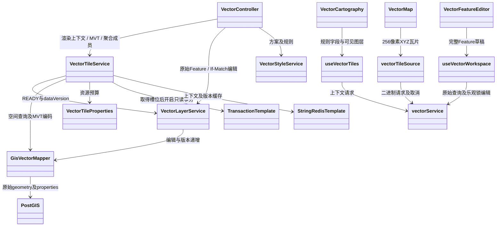
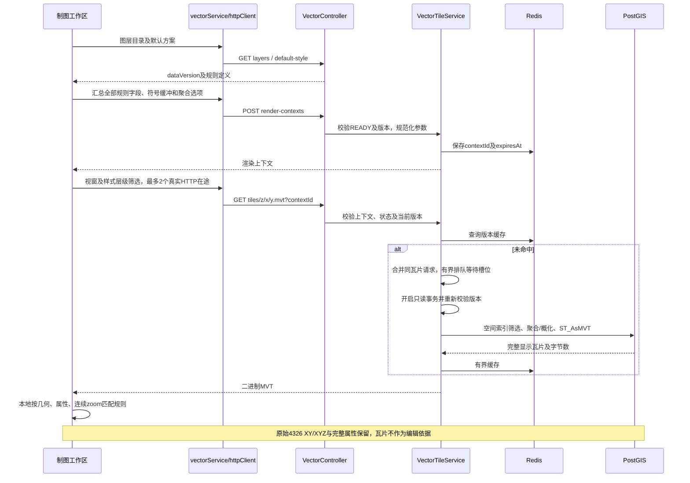
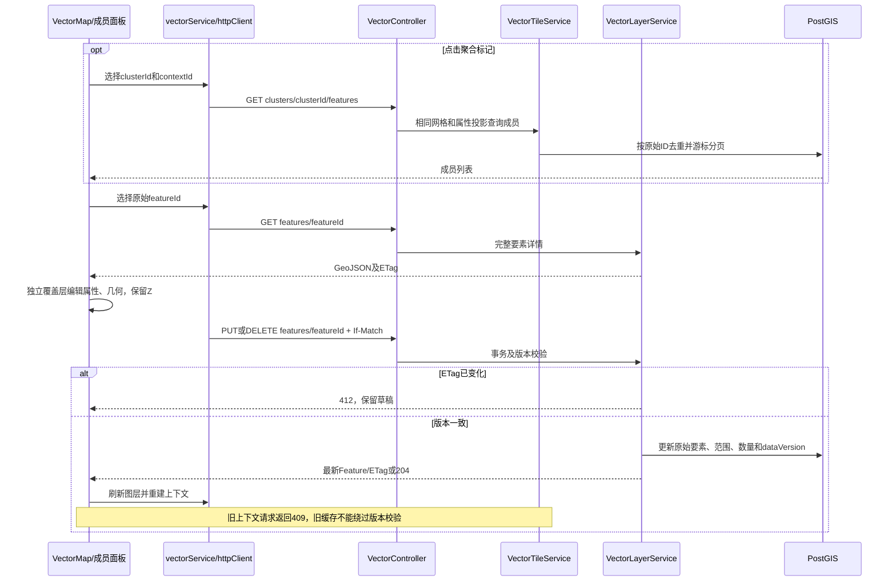

# Ocean Admin Service 架构说明

## 技术基线

- Java 21
- Spring Boot 4
- Spring WebSocket
- MyBatis-Plus
- JWT（登录鉴权）
- PostgreSQL （数据库服务）
- Flyway （数据库迁移）
- Redis （缓存中间件）
- Knief4j （接口文档）

## 当前边界

当前只建设三个平台侧领域：

1. `identity`：用户、平台、角色、权限、认证和会话。
2. `audit`：登录、操作、安全和异常审计。
3. `workbench`：通用平台指标与业务卡片聚合。

三个领域位于同一个 `ocean-platform-core` Maven 模块，使用包边界隔离，避免初期过度拆分。

## 未来业务子平台

新的业务子平台添加为 `ocean-business-<code>` Maven 模块，例如：

```text
ocean-business-vision
ocean-business-analyst
ocean-business-cloud
```

业务模块只能通过 `org.ocean.admin.platform.api` 使用平台能力。禁止直接访问平台模块的实体、Mapper 和数据表。

## 数据所有权

平台业务使用 `ocean_platform` Schema，平台核心表采用 `sys_` 前缀；GIS 业务使用 `ocean_gis` Schema，表采用 `gis_` 前缀。两个 Schema 分别维护唯一的初始化 SQL，业务对象不跨 Schema 混写。

GIS 文件传输与空间元数据提取分阶段执行。原始文件保存在文件存储，PostGIS 保存图层范围及源空间参考；普通文件在元数据完成后计入导入成功，矢量数据集的 GeoJSON 自动继续生成可编辑图层。后台任务使用数据库待办、版本与租约恢复，查询通过空间索引在同一图层上组合矩形与推荐层级条件。

可编辑矢量业务位于 `ocean-business-geo`。`VectorImportService` 从已上传 GeoJSON 流式读取并分批写入真实要素，`VectorImportWorker` 通过独立线程池和数据库租约执行任务；仅整次导入成功后开放图层。导入任务、图层与要素独立建模，首期 SINGLE 模式为一文件生成一个图层，关系允许后续扩展多个图层。现有静态瓦片处理与发布流程继续负责静态成果。

`FileSpatialMetadataService` 在元数据提交事务中调用 `VectorImportService.enqueueUploadedSource` 创建任务并关联原上传明细，提交即具备可恢复的入库待办。矢量任务终态、图层 READY 和原明细成功状态在同一事务提交。`FileTransferRecordService` 汇总批次并在提交后推送统一进度；`FileUploadService.retryImport` 根据失败阶段重试，复用原文件、任务和图层，跳过成功文件。批次详情提供矢量任务号、状态及图层 ID 数组。已管理文件的显式入库继续复用相同矢量执行能力。

`VectorLayerService` 提供真实几何范围查询及要素编辑，以图层行锁维护数量、范围和数据版本，以要素版本及 HTTP If-Match 防止编辑覆盖。来源文件保持为导入时的数据依据；制图查询访问当前要素，编辑不回写原文件。空间响应使用 GeoJSON，图层及任务管理响应使用统一 ResponseResult。

`VectorStyleService` 管理图层关联的多份样式方案、默认选择及独立ETag版本。`VectorImportService` 创建图层时在同一事务创建默认样式；样式写操作锁定图层但不递增 dataVersion。默认切换同时更新原方案和目标方案版本，数据库以部分唯一索引阻止多个默认方案，业务禁止删除当前默认方案。逻辑删除图层后其样式不再可访问。

`VectorStyleRules` 定义引擎无关的 schemaVersion=1 协议，负责有界规则校验、符号默认值补齐及几何/属性/连续zoom匹配。规则取首个匹配项，未匹配隐藏，GeometryCollection按子几何路径匹配并保留要素身份。后端提供持久化定义与匹配预览，前端读取定义后本地渲染；样式不改变要素查询、编辑语义或分页游标，也不作为数据访问权限。

旧式 GeoJSON 的兼容限制在文件入口：`FileSpatialMetadataService` 与文件要素读取共用 `GeoJsonFeatureReader.readSourceCrs`，仅接受顶层明确的 WGS84 命名声明，坐标不转换。子级声明、未知坐标系、空声明和链接型声明拒绝导入；在线编辑继续遵循 RFC 7946。该支持作为长期导入能力保留，停用这些来源并转换存量文件后可移除。

### 动态矢量瓦片及编辑链路

`VectorTileService` 在 GIS 业务模块生成只读显示数据：渲染上下文固定图层数据版本、规则字段清单、聚合及缓冲参数，Redis持久化短期上下文并限制瓦片缓存份数。PostGIS以现有空间索引筛选候选要素，集合递归拆分、点按网格和属性投影聚合，生成MVT；原始几何、属性和版本仍由 `VectorLayerService` 管理。点聚合以投影属性JSON保持规则匹配等价，成员查询返回不同原始要素，不以瓦片片段计数。超时、并发和字节预算超过时明确失败，不静默截断。







前端 `VectorMap` 使用MVT的轻量RenderFeature，`vectorTileSource` 负责二进制加载、订阅取消及重入恢复，`vectorService` 管理所有图层共享的真实HTTP并发队列。同一瓦片多个订阅共享请求；排队订阅取消后不发送，已发HTTP完成前仍占用槽位，避免残留JDBC查询与新请求叠加。已知图层范围及当前全部隐藏的样式规则在发请求前筛除。后端合并同瓦片生成，按4个执行槽位和32个排队位置保护查询，并在取得槽位后开启事务、重新校验版本；等待不占用数据库连接。

SQL对普通几何走直接路径，仅对集合做逐要素递归；使用现有空间索引、按需属性投影及单次MVT裁剪，避免全量递归物化和重复计算，空间事务局部关闭JIT。密集线面仍需按比例尺控制显示或进一步预概化，不能用扩大并发代替多尺度数据组织。

选中要素另以完整GeoJSON覆盖。XYZ几何支持已有顶点拖动，插入顶点需明确高程。样式颜色和透明度只重绘；字段清单或缓冲变化重建上下文。显示状态以图层及瓦片加载为准，不能用瓦片片段数量充当视窗要素总数。

## 安全约束
