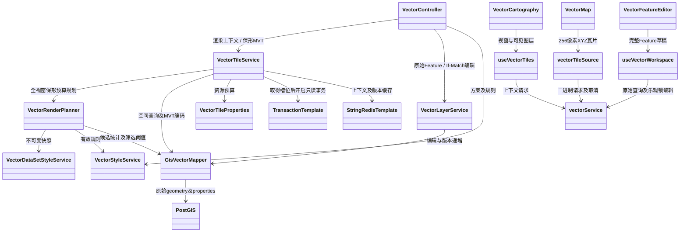
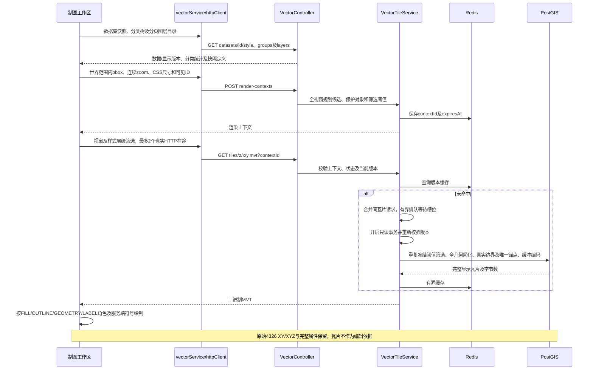
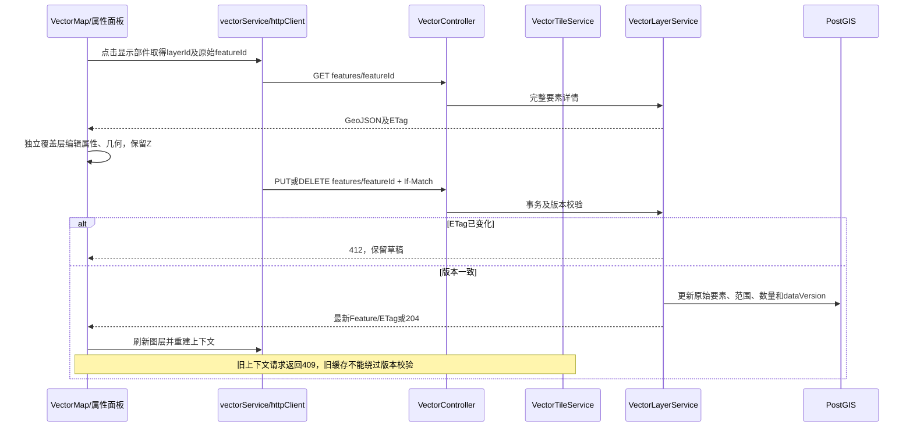

# Ocean Admin Service 架构说明

## 技术基线

- Java 21
- Spring Boot 4
- Spring MVC SSE
- MyBatis-Plus
- JWT（登录鉴权）
- PostgreSQL （数据库服务）
- Flyway （数据库迁移）
- Redis （缓存中间件）
- Knief4j （接口文档）

## 当前边界

当前只建设三个平台侧领域：

1. `identity`：用户、平台、角色、权限、认证和会话。
2. `audit`：登录、操作、安全和异常审计。
3. `workbench`：通用平台指标与业务卡片聚合。

三个领域位于同一个 `ocean-platform-core` Maven 模块，使用包边界隔离，避免初期过度拆分。

## 未来业务子平台

新的业务子平台添加为 `ocean-business-<code>` Maven 模块，例如：

```text
ocean-business-vision
ocean-business-analyst
ocean-business-cloud
```

业务模块只能通过 `org.ocean.admin.platform.api` 使用平台能力。禁止直接访问平台模块的实体、Mapper 和数据表。

## 数据所有权

统一实时事件信封 `EventMessage<T>` 与发布契约 `RealtimeEventPublisher` 位于 `ocean-kernel` 的 `org.ocean.admin.kernel.realtime` 包，不依赖Web、Servlet或SSE实现。SSE传输位于 `ocean-bootstrap` 的 `org.ocean.admin.web.realtime` 包，作为Web接入与技术装配实现发布契约；平台和GIS模块只依赖kernel中的契约，不反向依赖bootstrap。进度快照、业务投影与数据库重建位于GIS模块的 `progress` 包。RealtimeEventController分别提供 `/api/platform/events/stream` 与 `/api/gis/events/stream`，由服务端固定事件域为platform与gis，省略topics仅订阅所属域，跨域主题返回400，不保留全域入口。RealtimeSsePublisher复用有界串行发送、心跳、异步回收与全局资源上限，连接的投递范围互相隔离；bootstrap中的WebConfig在两个入口的MVC异步响应初始化后激活发送，避免框架内部早期缓冲绕过应用队列上限。工作台SystemMetricsEventService仅生产platform.metrics.updated事件，有匹配的平台订阅者时每2秒采集，GIS连接不会触发系统指标采集。两侧SSE均可承载进度之外的域内事件，各类型自定义消息体。所有事件以app.event帧发送，不提供SSE历史重放；前端每次GIS连接成功后通过既有HTTP接口补查状态，按epoch/sequence合并。鉴权暂不调整，两个SSE入口继续公开访问，域隔离与主题筛选仅控制投递范围。

`ProgressSnapshot.progressId` 是字符串进度键：上传使用recordNo，处理使用taskNo，工作区使用workspace编号，归档使用archiveNo。业务对象身份独立通过resource表达。进度版本使用持久化epoch和代次内sequence；重试或重建递增epoch，普通快照查询不增代次。业务Service决定终态，进度中心验证并发布完整快照，不能根据工作量计数推断业务成果是否成功。

工作区接入复用 `taskExecutor`、`RealtimeProgressService` 和 `/api/gis/events/stream`，不新增任务或传输表。请求只校验入口并返回202，后台流式遍历、逐文件短事务登记，运行态将新文件关联到本次进度。空间提取成功、失败、源失效或删除事件在事务提交后汇总进度，避免数据库回滚却推送成功；登记后读取一次文件状态，关闭通知早于运行态关联建立的竞态。扫描总量未知时只报告已扫描数，扫描结束才计算解析百分比，所有新文件进入元数据终态后才结束接入。统一补查入口为 `/api/gis/progress/{progressId}`。工作区运行态及终态短期查询属于本实例能力，服务重启不恢复目录扫描；持久化的文件提取待办继续按既有租约机制恢复。

平台业务使用 `ocean_platform` Schema，平台核心表采用 `sys_` 前缀；GIS 业务使用 `ocean_gis` Schema，表采用 `gis_` 前缀。两个 Schema 分别维护唯一的初始化 SQL，业务对象不跨 Schema 混写。

GIS 文件传输与空间元数据提取分阶段执行。原始文件保存在文件存储，PostGIS 保存图层范围及源空间参考；普通文件在元数据完成后计入导入成功，矢量数据集的 GeoJSON 自动继续生成可编辑图层。后台任务使用数据库待办、版本与租约恢复，查询通过空间索引在同一图层上组合矩形与推荐层级条件。

可编辑矢量业务位于 `ocean-business-geo`。`FileSpatialMetadataService` 在文件元数据领取周期内流式读取 GeoJSON、分批写入真实要素，并在完整成功后开放图层。首期一文件生成一个图层，文件、图层与要素直接关联，不建立独立矢量导入任务。现有静态瓦片处理与发布流程继续负责静态成果。

`gis_file_meta` 的元数据状态、版本和租约是文件提取流程的唯一权威状态。矢量解析中断后重新领取同一文件，先清理未完成图层再从头提取；成功图层不会被元数据重试覆盖。图层 READY、文件元数据 COMPLETED 和原上传明细 SUCCESS 在同一事务提交。`FileTransferRecordService` 汇总批次并返回由文件直接关联的图层 ID。

`VectorLayerService` 提供真实几何范围查询及要素编辑，以图层行锁维护数量、范围和数据版本，以要素版本及 HTTP If-Match 防止编辑覆盖。来源文件保持为提取时的数据依据；制图查询访问当前要素，编辑不回写原文件。空间响应使用 GeoJSON，图层管理响应使用统一 ResponseResult。

`VectorStyleService` 管理图层关联的多份样式方案、默认选择及独立ETag版本。`FileSpatialMetadataService` 创建矢量图层时在同一事务创建默认样式；样式写操作锁定图层但不递增 dataVersion。默认切换同时更新原方案和目标方案版本，数据库以部分唯一索引阻止多个默认方案，业务禁止删除当前默认方案。逻辑删除图层后其样式不再可访问。

`VectorStyleRules` 定义引擎无关的 schemaVersion=1 协议，负责有界规则校验、符号默认值补齐及几何/属性/连续zoom匹配。规则取首个匹配项，未匹配隐藏，GeometryCollection按子几何路径匹配并保留要素身份。后端提供持久化定义与匹配预览，前端读取定义后本地渲染；样式不改变要素查询、编辑语义或分页游标，也不作为数据访问权限。

旧式 GeoJSON 的兼容限制在文件入口：`FileSpatialMetadataService` 与文件要素读取共用 `GeoJsonFeatureReader.readSourceCrs`，仅接受顶层明确的 WGS84 命名声明，坐标不转换。子级声明、未知坐标系、空声明和链接型声明拒绝导入；在线编辑继续遵循 RFC 7946。该支持作为长期导入能力保留，停用这些来源并转换存量文件后可移除。

### 动态矢量瓦片及编辑链路

`VectorTileService` 在 GIS 业务模块生成只读显示数据：`VectorRenderPlanner` 固定数据/显示版本、视窗、样式、预算与筛选阈值，Redis持久化短期上下文并限制缓存份数。PostGIS 使用现有空间索引，按属性、连续级别及屏幕尺寸筛选、简化并编码MVT。点、线、面均不网格聚合，点和行政边界受预算保护；其他线面按业务级别和屏幕尺寸保形选择，等值桶不按ID截断。面分别输出无描边填充、裁剪前提取的真实边界，文字只输出到锚点归属瓦片。源几何、属性和版本由 `VectorLayerService` 管理；预算或资源超限明确失败，禁止全量回退。







前端 `VectorMap` 使用MVT的轻量RenderFeature，`vectorTileSource` 负责二进制加载、订阅取消及重入恢复，`vectorService` 管理所有图层共享的真实HTTP并发队列。同一瓦片多个订阅共享请求；排队订阅取消后不发送，已发HTTP完成前仍占用槽位，避免残留JDBC查询与新请求叠加。后端在空间查询前排除当前级别整层不可能显示的计划。后端合并同瓦片生成，按4个执行槽位和32个排队位置保护查询，并在取得槽位后开启事务、重新校验版本；等待不占用数据库连接。

候选统计与瓦片共享同一SQL筛选链路，先按视窗和规则过滤，简化在瓦片裁剪之前完成。MVT extent=4096、buffer=1024；前端 renderBuffer=64。稳定标注锚点只属于一个XYZ瓦片，避免逐片重复标注。数据库不存储派生概化几何；确需静态发布时走独立发布任务，不扩大动态并发。

选中要素另以完整GeoJSON覆盖。XYZ几何支持已有顶点拖动，插入顶点需明确高程。样式颜色和透明度只重绘；视窗、显示开关、版本或样式变化重建上下文。显示状态以图层及瓦片加载为准，不能用瓦片片段数量充当视窗要素总数。

## 安全约束
