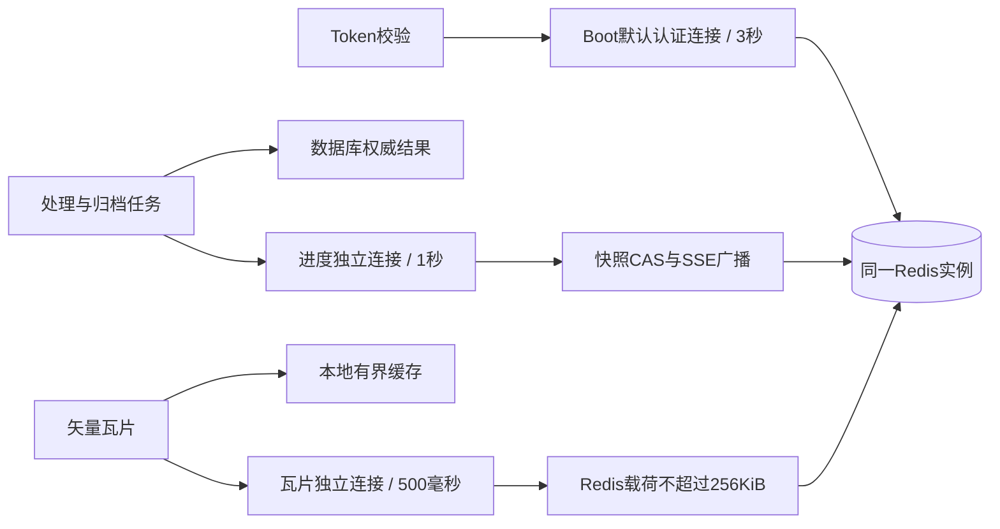

# 本地 PostgreSQL 与 Redis 容器

## 配置对应关系

| 服务 | 镜像 | 容器名 | 本地端口 | 数据/认证 |
| --- | --- | --- | --- | --- |
| PostgreSQL/PostGIS | `postgis/postgis:16-3.5-alpine` | `ocean-admin-postgres` | `5432` | 数据库、用户和密码均为 `ocean_admin` |
| Redis | `redis:7-alpine` | `ocean-admin-redis` | `6379` | 密码为 `123456`，默认 DB 为 `0` |

数据分别保存在 Docker 命名卷 `ocean-admin-postgres-data` 和 `ocean-admin-redis-data` 中，重建容器时不会随容器删除。

## 创建并启动

以下 PowerShell 命令仅使用本机已有镜像，不执行镜像拉取：

```powershell
docker run -d `
  --name ocean-admin-postgres `
  --restart unless-stopped `
  -e POSTGRES_DB=ocean_admin `
  -e POSTGRES_USER=ocean_admin `
  -e POSTGRES_PASSWORD=ocean_admin `
  -p 5432:5432 `
  -v ocean-admin-postgres-data:/var/lib/postgresql/data `
  --health-cmd="pg_isready -U ocean_admin -d ocean_admin" `
  --health-interval=5s `
  --health-timeout=3s `
  --health-retries=10 `
  postgis/postgis:16-3.5-alpine

docker run -d `
  --name ocean-admin-redis `
  --restart unless-stopped `
  -p 6379:6379 `
  -v ocean-admin-redis-data:/data `
  --health-cmd="redis-cli -a 123456 ping" `
  --health-interval=5s `
  --health-timeout=3s `
  --health-retries=10 `
  redis:7-alpine `
  redis-server --requirepass 123456 --appendonly yes
```

## 验证

```powershell
docker ps --filter "name=ocean-admin-" --format "table {{.Names}}\t{{.Image}}\t{{.Status}}\t{{.Ports}}"
docker exec ocean-admin-postgres pg_isready -U ocean_admin -d ocean_admin
docker exec ocean-admin-postgres psql -U ocean_admin -d ocean_admin -c "SELECT current_database(), current_user;"
docker exec ocean-admin-postgres psql -U ocean_admin -d ocean_admin -c "SELECT postgis_full_version();"
docker exec ocean-admin-redis redis-cli -a 123456 ping
```

Redis 验证命令可能输出一条在命令行传递密码的安全提示，本地开发环境中可忽略；返回 `PONG` 即表示连接成功。

## 日常启停

```powershell
docker stop ocean-admin-postgres ocean-admin-redis
docker start ocean-admin-postgres ocean-admin-redis
docker logs -f ocean-admin-postgres
docker logs -f ocean-admin-redis
```

## 应用连接配置

仓库默认值已经可以直接连接上述容器。需要显式设置时：

```powershell
$env:DB_URL='jdbc:postgresql://localhost:5432/ocean_admin'
$env:DB_USERNAME='ocean_admin'
$env:DB_PASSWORD='ocean_admin'
$env:REDIS_HOST='localhost'
$env:REDIS_PORT='6379'
$env:REDIS_PASSWORD='123456'
$env:REDIS_DB='0'
```

## Redis 超时专项修复（2026-11-05）

### 定位证据与结论

- `target/zoom-contract-backend.out.log` 中 10:40:58 的异常链为 `GeoTiffPreprocessor.prepareLocked → ProcessingTaskLifecycleService.reportProgress → RealtimeProgressService.change → Redis GET`，客户端等待 3 秒后超时。影像第 8/14 个分块已经完成，失败来自同步进度通知，不是该分块计算失败。
- 认证会话、进度 GET/CAS、SSE PUBLISH 和矢量瓦片此前共用 Boot 默认的 Lettuce 原生连接。瓦片以未压缩字节的 Base64 写入 Redis，允许的解码上限为 16 MiB，单次 Redis 参数可超过 21 MiB；HTTP 的 GZIP 不会压缩这条 Redis 通道。大载荷会放大连接排队、网络传输和 JVM 分配压力。
- 排查时业务 Redis 为 7.4.11，运行 7 天；`blocked_clients=0`、`rejected_connections=0`、`evicted_keys=0`、`aof_delayed_fsync=0`。最近 20 条慢日志最大约 36.8 ms，故障时段没有重启或持久化失败。该样本不支持“Redis 执行了 3 秒慢命令”的结论，但不能排除历史瞬时宿主机/网络停顿。
- 同时存在高频完整渲染策略 SQL 参数日志。11 月 4 日归档编号达到 870，增加了磁盘和内存压力。本次将 `GisVectorMapper` 日志设为 INFO。
- 确认的缺陷是共享大载荷连接，以及把通知失败传播成业务失败；无法仅靠事后日志唯一确认当时的网络、WSL 调度或 JVM 停顿。后续若仍出现认证超时，应关联 JVM GC/线程、宿主机资源、Redis 慢日志及两端延迟采样。

### 修复设计



1. 保留 Boot 默认连接配置与认证 Lua 原子会话校验；额外工厂及模板通过显式限定注入进度和瓦片服务，连接生命周期由 Spring 管理。普通请求不通过增加连接池来掩盖共享连接问题。
2. 三条连接均开启 TCP keepalive、命令过期与有界请求队列；断线时拒绝继续积压命令，由 Lettuce 自动重连。连接隔离只能消除客户端连接间的干扰，不能隔离同一 Redis 实例或宿主机的整体停顿。
3. 瓦片读写两侧限制 Base64 载荷；读取通过 Lua 在服务端原子检查长度，超限视为未命中。超限结果仍可进入已有的有界本地缓存。淘汰使用 `UNLINK`，避免同步释放大值。缓存故障暂停共享缓存访问 5 秒，空间查询仍受原有并发和队列上限控制。
4. 影像、地形、矢量处理及归档的 Redis 投影异常不会终止业务执行；暂停投影 5 秒后再尝试，查询可从数据库读取真实结果。丢失的中间进度不逐条重放，最终计数从数据库补齐，避免通知失败将成功任务改为失败。故障期间补查终态会推进数据库中的进度 epoch，避免客户端忽略序号为 0 的恢复快照；Redis 恢复后通过 CAS 替换较旧 epoch 的快照。运行中补查不推进 epoch，保持任务执行句柄有效。数据库失败、无效业务状态和 CAS 冲突仍按原逻辑报错。
5. 上传/工作区接入的临时状态和执行租约继续严格依赖 Redis；不会在无法确认锁所有权时放行。SSE 广播失败记录诊断日志并暂停广播，客户端使用现有补查接口获取结果。
6. Token 校验遇到 Redis 故障返回 HTTP 503 和“认证服务暂不可用”，不会返回有效，也不会当作 Token 过期。Redis 恢复后仍检查服务端会话，已注销 Token 不能重新生效。

| 环境变量 | 默认值 | 用途 |
| --- | --- | --- |
| `REDIS_COMMAND_TIMEOUT` | `3s` | 认证命令超时，保留原值 |
| `REDIS_CONNECT_TIMEOUT` | `2s` | TCP 连接超时 |
| `REDIS_PROGRESS_TIMEOUT` | `1s` | 进度命令超时 |
| `REDIS_TILE_TIMEOUT` | `500ms` | 瓦片缓存命令超时 |
| `REDIS_REQUEST_QUEUE_SIZE` | `128` | 每条连接的待处理命令上限 |
| `GIS_VECTOR_TILE_REDIS_VALUE_BYTES` | `262144` | Redis 瓦片值的编码字节上限，最多允许配置为 1 MiB |

上线需重新构建并重启应用，Redis 无需清库或迁移。已经持久化为 FAILED 的任务不会自动改为成功，应在新版本运行后重新提交。Redis 故障期间实时进度可能暂时停止刷新，但数据库中的任务详情和最终结果保持权威。

### 专项验证结果

- 执行 `mvn -q -pl ocean-bootstrap -am test '-Dtest=RedisResilienceTest' '-Dsurefire.failIfNoSpecifiedTests=false'`：10 项通过，0 失败、0 错误、0 跳过。测试源码按仓库约束删除，结果保留在 `ocean-bootstrap/target/surefire-reports/`。
- 在独立临时 Redis 容器（本地端口 16389，无业务数据卷）执行 `CLIENT PAUSE 500 ALL` 注入故障，验证认证返回 503、恢复后会话可用、注销后失效、进度故障不抛回任务、终态计数及 epoch 恢复、并发终态恢复不会把成功任务改为失败、上传执行锁仍拒绝不确定执行、SSE 广播故障隔离、瓦片载荷读写上限和缓存失败行为。
- 并发 4 路，每路 80 轮读写 256 KiB 值，同时执行 100 次 Token 校验，全部成功；最终一轮最大校验耗时 24 ms。这是隔离环境的客户端验证，不代表生产延迟 SLA，也未重新运行截图中的完整大影像任务。
- 测试先完成 Lettuce/Netty 冷启动初始化，再将故障命令预算缩短到 100 ms。恢复在限定的 3 秒窗口内校验；应用默认认证超时仍为 3 秒，没有靠延长业务命令超时规避问题。
- `git diff --check` 通过；生产源码未检出 Jackson 2 导入。临时测试容器在验证后停止并自动删除。
- 默认名称打包因 JAR 文件占用无法重命名；临时指定独立产物名称后，`mvn -q -pl ocean-bootstrap -am package -DskipTests` 成功，生成 `ocean-bootstrap/target/ocean-bootstrap-redis-fix.jar`，POM 已原样恢复。未重启当前运行的业务服务，部署新包后修复才会生效。

诊断时使用 `INFO`、`SLOWLOG GET`、`LATENCY LATEST` 及客户端名称 `ocean-auth`、`ocean-progress`、`ocean-tile-cache` 区分负载。慢日志参数可能包含会话或业务内容，只保留命令名、时间和耗时，避免输出原始参数。延迟监控默认未启用时，`LATENCY LATEST` 为空不能证明没有延迟。

依据：[Spring Data Redis 连接共享说明](https://docs.spring.io/spring-data/redis/reference/4.0/redis/drivers.html)、[Lettuce 队列与断线行为](https://redis.github.io/lettuce/advanced-usage/client-options/)。

## 清理

仅删除容器、保留数据卷：

```powershell
docker rm -f ocean-admin-postgres ocean-admin-redis
```

确认不再需要本地数据后，才删除数据卷：

```powershell
docker volume rm ocean-admin-postgres-data ocean-admin-redis-data
```
