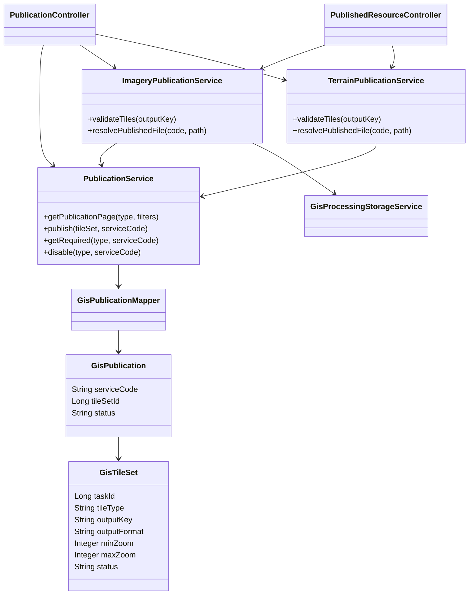
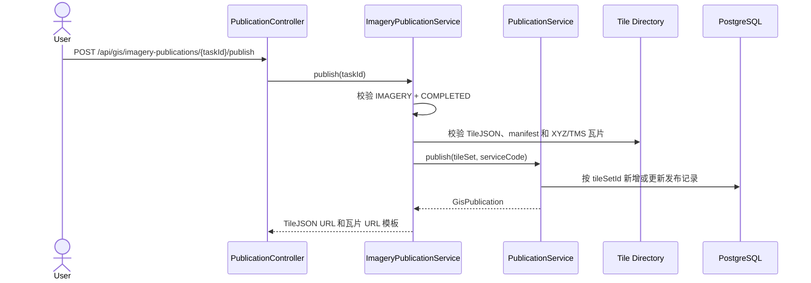
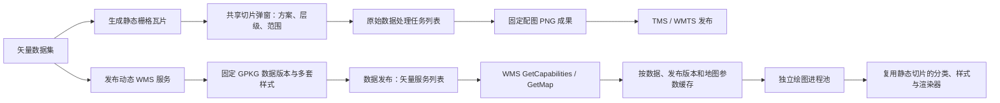

# 影像瓦片发布设计

## 设计目标

影像与地形共用发布记录和状态流转；发布记录直接关联静态瓦片集，不创建额外任务。统一控制器承接发布管理和静态资源响应，各类型服务保留独立的产物校验、公开 URL 和资源路径解析。影像数据面只暴露已发布的 TileJSON 和 XYZ/TMS PNG/JPEG 文件，并支持 WebMercatorQuad（EPSG:3857）与 WorldCRS84Quad（EPSG:4326）瓦片矩阵。

## 类图

## 发布时序

## 接口与状态

- 管理面：`/api/gis/imagery-publications`
- 数据面：`/imagery/{serviceCode}/tilejson.json`、`/imagery/{serviceCode}/{z}/{x}/{y}.{png|jpg}`
- `POST .../{sourceTaskId}/publish` 同时承担首次发布和重新启用。
- `PUT .../{serviceCode}/disable` 停用公开访问，但不删除切片产物。
- 状态仅允许 `PUBLISHED`、`DISABLED`。
- 服务编码使用 `TRN_`、`IMG_` 前缀；数据面按处理类型隔离。

## 安全约束

- 只允许发布 `COMPLETED` 的 `IMAGERY` 切片任务。
- `output_key` 必须位于 `imagery/` 命名空间。
- 发布前校验 `tilejson.json`、`manifest.json`、目标坐标系、瓦片矩阵、格式、层级和至少一张瓦片。
- 公开资源仅允许 TileJSON 和符合已发布格式、层级范围的 XYZ/TMS 路径。
- 所有文件路径必须规范化并保持在任务瓦片根目录内。

## 矢量配图静态 PNG 发布（2026-11-06）

当前统一管理入口为 `/api/gis/publications`，公开资源入口为 `/gis/publications/{processingType}/{serviceCode}`。矢量配图任务完成后，使用 `POST /api/gis/publications/VECTOR/{taskId}/publish` 提交服务名称，一次发布同时提供 TMS 和 WMTS。重复发布复用服务编号；停用后通过原任务重新发布即可启用。

- `VectorRasterPublicationService` 校验已完成任务、READY 瓦片集以及 EPSG:3857 / XYZ / PNG 成果，公开编码使用 `VRT_` 前缀。
- 发布记录关联 `tile_set_id`，与关联 `vector_resource_id` 的动态 MVT 服务分别处理，查询、重命名和停用按实际来源分派。静态成果展示切片时保存的样式。
- WMTS：`.../wmts?SERVICE=WMTS&REQUEST=GetCapabilities`，支持 KVP GetTile 及能力文档中的 REST 模板。矩阵标识为 `WebMercatorQuad`，256 像素，层级和有效行列范围来自成果。
- TMS：`.../tms/`、`.../tms/1.0.0/`、`.../tms/1.0.0/tilemap.xml` 构成发现链；瓦片地址为 `.../tms/1.0.0/{z}/{x}/{y}.png`。描述文件明确列出分辨率，使用 `profile="none"`，避免与早期 global-mercator 的四瓦片零级定义混淆。
- 物理成果保持 XYZ。TMS 请求将行号换算为 `2^z - 1 - y`；WMTS 直接使用顶端原点行号。两种协议读取同一文件，不复制瓦片、不读取 GPKG、不重新渲染。
- 发布详情中的 `serviceUrl`、`descriptorUrl`、`tileUrlTemplate` 指向 WMTS；`tmsUrl`、`tmsTileUrlTemplate` 分别提供 TMS 图层描述与瓦片模板。前端可切换两种服务预览。

### Cesium / EarthSDK 接入

- TMS 的 `{y}` 是自南向北的行号。通过 Cesium `UrlTemplateImageryProvider` 或 EarthSDK 在线 URL 模板加载时，必须把 TMS 地址中的 `{y}` 写成 `{reverseY}`。直接使用 `{y}` 会把 XYZ 行号发送给 TMS，造成南北瓦片错位。
- WMTS 专用客户端应读取能力文档。手动配置 `WebMapTileServiceImageryProvider` 时，`layer` 使用服务编号，`style` 为 `default`，`format` 为 `image/png`，`tileMatrixSetID` 为 `WebMercatorQuad`，投影使用 `WebMercatorTilingScheme`，最小和最大层级取发布详情。矩阵标识为数字字符串 `0`、`1` 等。
- 使用通用 URL 模板加载 WMTS REST 地址时，把 `{TileMatrix}/{TileRow}/{TileCol}` 改写为 `{z}/{y}/{x}`，保持行列顺序不变。发布详情提供两种 Cesium 模板供复制，均访问原有 TMS / WMTS 接口，不增加新的发布协议或修改服务端行号语义。
- 当前 EarthSDK 查看器会把含 `{z}`、`{x}`、`{y}` 的地址自动识别为 URL 模板；单独粘贴 WMTS 服务根地址不能替代图层和矩阵配置。其 WMTS 表单在未解析到图层时仍可生成空影像对象，需要核实图层参数是否完整。
- 每次访问校验发布状态，元数据缓存不绕过停用判断。PNG 使用 ETag 和 `Cache-Control: no-cache`，允许浏览器缓存并要求重新校验。

## 矢量数据集入口与动态 WMS（2026-11-06）

矢量数据集的卡片、列表菜单提供“生成静态栅格瓦片”和“发布动态 WMS 服务”，替换原通用“数据处理”入口。影像和地形的数据处理入口保持原流程。两个矢量入口都使用制图工作区中已保存的样式方案。

- `StaticRasterBuildDialog` 由数据集菜单和制图工作区共用。数据集入口选择保存方案；工作区入口可先保存草稿再提交。任务提交成功后，数据集入口跳转到数据处理列表。
- `POST /api/gis/publications/VECTOR/wms/publish` 使用现有 `GisVectorRequests.Publish`：数据集、名称、样式方案 ID 列表和默认方案 ID。直接创建发布记录，不生成处理任务；成功后跳转到数据发布的矢量服务列表。
- `gis_publication.service_protocol` 明确保存 `WMS`、`MVT`、`TMS_WMTS`、`XYZ`、`TMS` 或 `TERRAIN`。协议与 PNG/MVT 格式、XYZ/TMS 物理编号分别表达，前端不再通过成果格式推测服务协议。
- WMS 服务同样复用固定 `vector_resource_id` 和样式快照；更新发布样式生成新的发布版本，缓存键随之变化。停用后的请求返回 404，即使客户端带旧 ETag 也不会获得 304。
- 公开入口：`/gis/publications/VECTOR/{serviceCode}/wms`。支持 `GetCapabilities` 和 `GetMap`，版本为已确认的 `1.3.0`、`1.1.1`。暂不提供 `GetFeatureInfo`；能力文档声明 `queryable="0"`。
- `LAYERS` 为服务编号；`STYLES=default` 或空值采用默认发布方案，其他方案填写发布样式 ID。输出格式只允许 `image/png`。支持 `TRANSPARENT` 和 `BGCOLOR=0xRRGGBB`，单张图片最大 2048×2048。
- WMS 1.3.0 使用 `CRS`：EPSG:4326 的 `BBOX` 为南、西、北、东，EPSG:3857 为 minX,minY,maxX,maxY；CRS:84 为西、南、东、北。WMS 1.1.1 使用 `SRS`，EPSG:4326 为西、南、东、北。版本差异只在协议边界归一化，渲染器始终接收 x/y 范围。
- WMS 使用两个独立原生绘图进程，同一地图请求合并执行，唯一请求的执行与等待总数最多 18；等待执行最多 10 秒，原生进程请求最多 30 秒。图片缓存有条数、字节数及过期限制；不占用工作区 MVT 的进程池，也不进入离线切片任务队列。
- 发布详情提供协议、服务地址、能力文档、图层和默认样式参数，并可通过 OpenLayers 的真实 WMS 请求预览。对外地址统一使用 `gis.publication.public-base-url`。

### 本次验证边界

通过临时测试验证发布记录创建、旧 MVT 入口、WMS 两版轴序、参数错误、CORS、ETag、停用、缓存版本、并发请求合并与真实 GPKG 出图。能力文档分别使用 OGC 官方 1.3.0 XSD 和 1.1.1 DTD 校验；测试类验证后删除。

Windows 浏览器自动化无法可靠识别当前 URL，页面点击及 EarthSDK 联调未完成。主服务按用户要求保留运行状态，需用户手动重启加载新接口后再完成页面验收。
